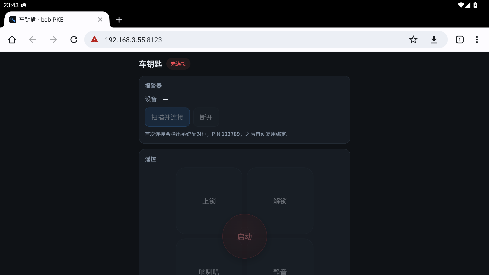
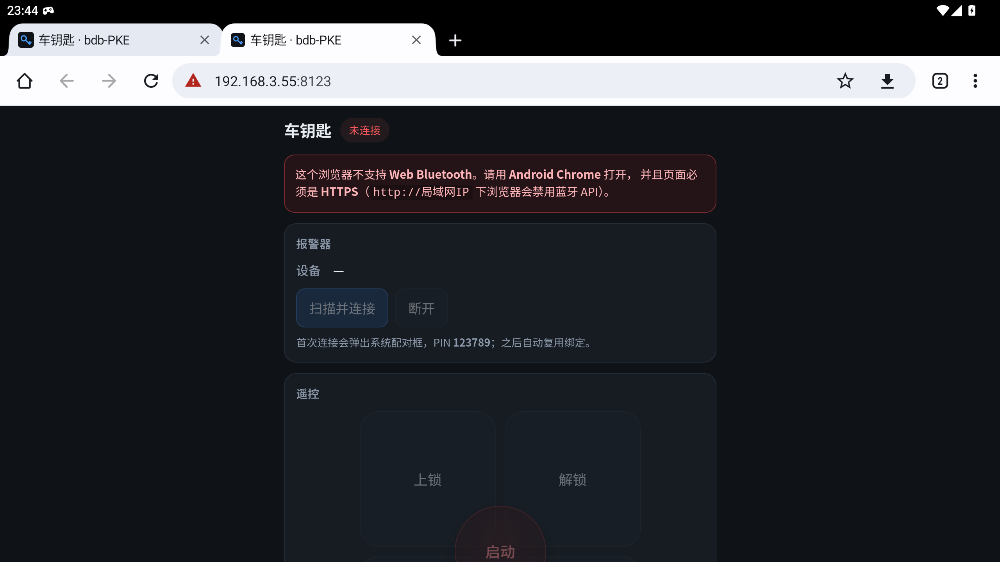

# pwa — Web Bluetooth（方案 A）

状态：已实现（协议层通过全部测试，UI 已在 Android 15 模拟器上渲染验证）。

## 运行要求

- **Android Chrome / Edge / Samsung Internet**（iOS Safari 不支持 Web Bluetooth）；
- **安全上下文**：`https://` 或 `localhost`。`http://192.168.x.x` 下浏览器会禁用
  `navigator.bluetooth`，页面会显示红色提示并禁用连接按钮（已实测）。

### 本机快速试（不想搭 HTTPS）

1. PC 上起静态服务：`python -m http.server 8123 --directory pwa`
2. 手机 Chrome 打开 `chrome://flags/#unsafely-treat-insecure-origin-as-secure`，
   填 `http://<PC-IP>:8123`，启用并重启浏览器；
3. 打开页面即可用（仅调试用，别长期这么开）。

### 正式部署

把 `pwa/` 目录整个托管到任意 HTTPS 静态站（GitHub Pages / Vercel / 自己的 nginx），
手机打开即用，可"添加到主屏幕"当 App。

## 文件

| 文件 | 作用 |
|---|---|
| `src/aes.js` | AES-128-ECB（WebCrypto 不支持 ECB，自己实现；FIPS-197 向量校验） |
| `src/protocol.js` | 帧编解码、状态解析、`createLink()` 状态机（与 `tests/reference` 对拍） |
| `src/ble.js` | Web Bluetooth：按 UUID 发现写/通知特征、订阅、写 |
| `app.js` | UI 逻辑：连接、五个按键、状态刷新、日志 |
| `index.html` | 车钥匙盘（2×2 + 中间圆形启动键）、状态卡、日志卡 |
| `manifest.json` / `sw.js` | PWA 安装与离线缓存 |

## 行为要点

- 首次连接由**系统**弹 PIN 框（`123789`），页面不能代填；
- 一键启动：**连按两次**"启动"（每次点击发 `06`+`16` 一对），第一次只短响；
- 熄火：点"解锁"；
- 启动动作后**不发** `A6` 查询（会清掉设备"等第二次按键"的状态）；
- 其它动作后 600 ms 自动补一次 `A6`，另每 6 秒查一次状态。

## 模拟器验证结论（MuMu，Android 15）

- 页面渲染、`未连接` 状态、按键禁用态、HTTPS/Web Bluetooth 提示都正常；
- **MuMu 没有蓝牙适配器**（`dumpsys bluetooth_manager` 显示 `address: null`，
  `svc bluetooth enable` 后仍 OFF），所以 Web Bluetooth 连接只能在真机上验证。

